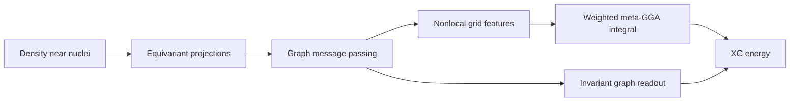

**Paper:** Gao, Eberhard and Günnemann, *Learning Equivariant Non-Local Electron Density Functionals* (ICLR 2025). [Conference paper](https://proceedings.iclr.cc/paper_files/paper/2025/file/7d95d65059958ba8667be1f642c6447c-Paper-Conference.pdf) · [author code](https://github.com/eseberhard/eg-ex).

## TL;DR

EG-XC compresses the density around nuclei, passes information between these representations with an equivariant graph network, and uses the result to construct XC energy contributions. This introduces molecular-range information without connecting every fine integration-grid point to every other one.

## The problem

A molecular integration grid is large. Full communication between all its points is costly. On the other hand, evaluating a separate local function at every point prevents regions from learning about each other.

There is a second issue: direction matters internally, even though the final energy must not depend on the arbitrary orientation of the molecule. Throwing away all angular information too early can make the representation less expressive.

## The key idea

Compress locally, communicate on a smaller graph, then use the communicated information in the energy evaluation. Let the intermediate angular features rotate in a predictable way. This is **equivariance**.

For an energy model, rotation invariance means $E[R\rho]=E[\rho]$. For an intermediate vector-like feature, equivariance means $h[R\rho]=Rh[\rho]$. A vector changes components when the coordinate axes rotate; its length does not. More general spherical-harmonic features follow the corresponding rotation rules.

*Original schematic of the paper's four components. Both energy branches matter.*

## How it works

First, radial filters and spherical harmonics project density around nuclear positions into a finite collection of features. Next, equivariant message passing combines features on neighbouring graph nodes with their geometric relationships. Repeated updates extend the effective range of information.

The resulting representation supplies two readouts. One constructs a nonlocal feature field on the integration grid and uses it to reweight a meta-GGA energy density. The other predicts a summed graph correction. Schematically,

$$E_{\mathrm{xc}}=\int\rho(\mathbf r)\,
\gamma_{\mathrm{NL}}(\mathbf r)\varepsilon_{\mathrm{mGGA}}(\mathbf r)\,d\mathbf r
+\sum_I\varepsilon_{\mathrm{NL}}(h_I).$$

The first term retains a density-integral structure. The second reads out invariant components of the graph features. The nuclear positions define centres, while the electronic embeddings are derived from the density; this is not simply a conventional atom-type force field with a different name.

Training differentiates through the electronic minimization using energy supervision. This puts the architecture in the same broad solver-aware family as [[papers/kohn-sham-regularizer|the Kohn–Sham regularizer]], now with a three-dimensional representation suited to molecular structure.

## Results that matter

The paper evaluates molecular trajectories and extrapolation to unfamiliar conformations and larger molecules. It reports errors reduced by roughly a factor of two to three relative to its learned semilocal comparator on the stated tests, with further comparisons against direct and delta-learned force fields.

Those comparisons are informative about representation and transfer in the evaluated setting. They are not a GMTKN55 result or a demonstration of universal coupled-cluster accuracy. Reference methods, molecular families and training splits define what has actually been learned.

## Limitations

Graph compression and finite interaction ranges can discard information. Equivariance guarantees a symmetry property, not accuracy. A correct rotation law cannot repair missing training chemistry or an inadequate electronic representation.

Differentiable self-consistent training also has a computational price. The original motivation—efficient nonlocal information—must be evaluated together with training cost, inference cost and convergence behaviour.

## My take

Read this paper to understand why a graph enters a density functional at all. Its role is to move information economically between electronic neighbourhoods. [[papers/skala|Skala]] pursues a related broad idea of learned nonlocal representations, with a different architecture, training protocol and much larger high-accuracy dataset.

> [!todo] Things to check
> - Explain the difference between invariant energy and equivariant internal features with a rotated vector.
> - Check the reference electronic-structure method for each dataset before interpreting a reported error.
