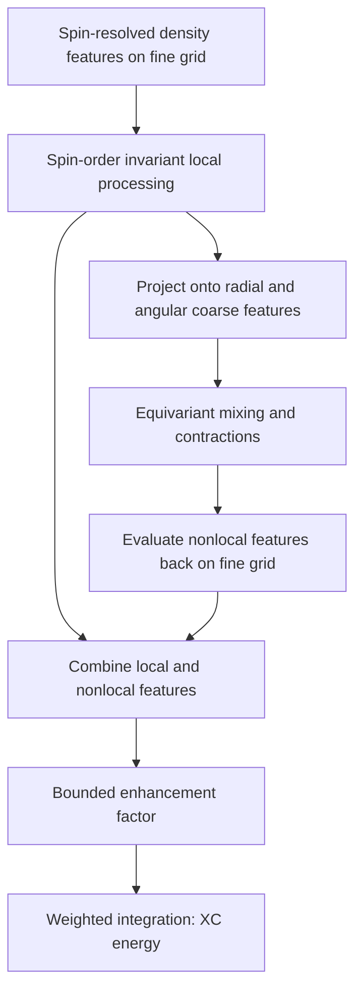

**Paper:** Luise et al., *Accurate and scalable exchange-correlation with deep learning*. First posted June 2025; this note uses **arXiv v6, 21 April 2026**, describing Skala-1.1. [Versioned full text](https://arxiv.org/abs/2506.14665v6) · [model and inference code](https://github.com/microsoft/skala). The version matters: results and training data changed during development.

## TL;DR

Skala combines a learned nonlocal density representation with a large collection of accurate energy differences and a two-stage training procedure. It reports a GMTKN55 WTMAD-2 of 2.80 kcal/mol while avoiding conventional exact exchange. This is a substantial result for the speed–accuracy question, with important qualifications about the benchmark, dispersion correction and timing boundary.

## The problem

[[papers/becke-hybrids|Hybrids]] gain useful information through an expensive orbital-pair expression. [[papers/cider|CIDER]] asks whether specially designed descriptors can approximate that information. Skala takes another route: start from inexpensive electronic features and learn how information from different regions should be combined.

The challenge is not simply building a larger network. The integration grid is large; the energy must have sensible symmetries, size behaviour and derivatives; training data at sufficiently high accuracy are expensive; and the model must work on densities it produces itself.

## The key idea

Separate the fine grid needed for numerical integration from a coarser representation used to communicate nonlocal information. Combine that architecture with about 400,000 training energy differences and enough self-consistent training to connect the fixed-density fit to actual deployment.

The energy form is

$$E_{\mathrm{xc}}^\theta=-\frac34\left(\frac6\pi\right)^{1/3}
\int\left(\rho_\uparrow^{4/3}+\rho_\downarrow^{4/3}\right)
f_\theta[\mathbf x[\rho]](\mathbf r)\,d\mathbf r.$$

The density powers provide an exchange-like scale. $\mathbf x$ contains inexpensive meta-GGA-level features. The learned, bounded enhancement factor is a **functional of the feature field**, not just an independent function of the feature vector at the current point. That distinction is where nonlocality enters.

## How it works

*Original schematic of the architecture in v6. It summarizes the fine-to-coarse-to-fine information path; it is not a copied paper figure.*

Downsampling integrates fine-grid features against radial functions and spherical harmonics around coarse points placed at atomic centres. This collects directional information somewhat like multipole moments. Equivariant mixing and symmetric contractions process those features. Evaluating the resulting functions back on the fine grid supplies nonlocal context to local energy prediction.

The architecture has a defined dense-grid limit, so changing the quadrature grid does not mean changing the fundamental learned object. Numerical convergence still needs checking. The whole model has 385,217 parameters in this version—small compared with many modern networks, because it must be evaluated within repeated electronic calculations.

Training has two phases. During **pretraining**, the model sees fixed B3LYP densities/orbitals and learns accurate reaction-energy differences. Those labels are generated with high-level wavefunction protocols; they are not B3LYP energy labels. During **fine-tuning**, it sees its own self-consistent densities, reducing the gap between fixed-density and deployed performance.

The paper explicitly avoids backpropagating through the full SCF loop in this fine-tuning procedure. Do not conflate it with the unrolled training of [[papers/kohn-sham-regularizer|Li et al.]] Both respond to self-consistency, but with different computational strategies.

The training collection combines large in-house datasets with public data. Molecular-graph filtering reduces overlap with test sets, with stated exceptions and different rules for some reaction classes. That protocol needs reading as written; “a completely untouched benchmark” would be too strong a shorthand.

## Results that matter

The following values are transcribed from **Table 1 of v6**, not calculated here. WTMAD-2 is the weighted GMTKN55 metric; it is not the mean error of every individual reaction.

| Functional in the paper's protocol | WTMAD-2 (kcal/mol) |
|---|---:|
| r2SCAN | 7.25 |
| B97M-V | 5.56 |
| B3LYP | 6.38 |
| ωB97M-V | 3.23 |
| Skala-1.1 | 2.80 |

Dispersion is part of this comparison. Skala uses a fixed **D3 correction**; the paper does not claim its learned representation alone provides complete dispersion. The listed methods use the paper's specified dispersion treatments, including built-in nonlocal correlation for the “-V” functionals.

The subset results are more revealing than a ranking. Skala's reported BH76 mean absolute error is 1.75 kcal/mol versus 1.33 for ωB97M-V, despite its better aggregate WTMAD-2. On SIE4x4, Skala still has a mean absolute error of 12.68 kcal/mol. A strong overall result can coexist with unresolved self-interaction-related failures.

The nonlocal-architecture ablation improves the average Diet GMTKN55 metric by about 50% relative to the paper's local model over five seeds. This is useful evidence that nonlocal information contributes beyond the dataset alone. Data-composition studies also show gains as chemical coverage expands.

**What exactly was timed?** Supplement D.7 describes a standalone GauXC driver starting from a supplied density matrix and evaluating XC energy and potential. It uses def2-TZVP, the GM3 grid and stated CPU/GPU virtual machines, including an A100 for the GPU results. These timings support the efficiency of the XC implementation. They are not full wall times from an initial molecular guess through all SCF iterations, retries and geometry steps.

## Limitations

The broad benchmark concerns main-group chemistry; it does not establish universal accuracy for materials, transition-metal electronic structure or strong correlation. Some difficult subsets remain difficult. The fixed dispersion correction is an additional ingredient. The full training collection is not entirely public, even though the model and inference code are available under MIT licensing.

An inexpensive XC model also leaves the rest of the Kohn–Sham calculation in place. Matrix construction, orbital solution and convergence still cost time. “Semilocal-like cost” should not be read as “a complete calculation is linear in system size.”

## My take

The important result is a concrete alternative to buying better chemistry primarily through expensive exact exchange. The important next question is how broadly it transfers and how it behaves in complete workflows. That is a much more useful starting point for Curiosophy than declaring the challenge finished.

> [!todo] Things to check
> - Keep the v6/Skala-1.1 results separate from older versions and later model releases.
> - Reproduce the benchmark protocol, dispersion treatment and timing boundary before making a new comparison.
